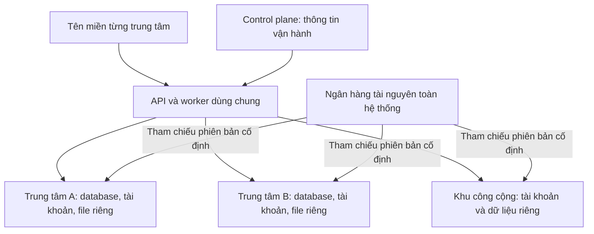

# Ranh giới dữ liệu trung tâm

## Phạm vi khảo sát

Đọc mã nguồn tại commit `dcfa1bfc9bf05745bfe05558707ced997a8bd799`.
Chưa kiểm tra registry của môi trường đang vận hành, chưa chạy lại test và
chưa thay đổi mã ứng dụng hoặc dữ liệu. Các điểm cần kiểm chứng dưới đây
không phải kết luận đã xảy ra truy cập chéo hoặc mất dữ liệu.

## Yêu cầu đã xác định

- Mỗi trung tâm có vòng đời dữ liệu độc lập: xuất, sao lưu, khôi phục và xoá.
- Tài khoản và hồ sơ độc lập theo trung tâm, không tự liên kết bằng email
  hoặc số điện thoại; đổi mật khẩu một nơi không tác động nơi khác.
- Ngân hàng chung gồm câu hỏi, đề mẫu, học liệu và chương trình.
- Dữ liệu học viên, bài làm, điểm và học phí thuộc riêng trung tâm.
- Dùng chung hạ tầng API/worker/PostgreSQL/Redis, nhưng mỗi trung tâm có
  database, quyền kết nối và vùng lưu file riêng.
- Tài nguyên trung tâm tạo mặc định riêng; gửi và duyệt công bố trước khi
  chia sẻ lên ngân hàng hệ thống.
- Quản trị trung tâm gửi tài nguyên thay mặt đơn vị sở hữu; ban biên tập
  hệ thống duyệt công bố, giáo viên chuẩn bị nội dung trong trung tâm.
- Dùng nguyên trạng tài nguyên chung bằng tham chiếu phiên bản cố định,
  không bắt buộc nhập/copy vào ngân hàng riêng. Tạo bản riêng khi cần sửa.
- Đề riêng có thể kết hợp câu chung và câu riêng. Trung tâm có thể giao đề
  chung bằng đợt giao riêng với lớp, lịch và cấu hình làm bài/chấm riêng.
- Hệ thống tự lưu bản chụp phục vụ thi/chấm và lịch sử; bài làm, điểm và
  nhận xét thuộc trung tâm. Phiên bản nguồn mới không sửa ngược đợt giao cũ.
- Khi nguồn bị rút, ngừng khám phá/tiếp nhận mới và cảnh báo; giữ phiên bản
  đã tham chiếu, bản riêng, bản chụp và lịch sử trung tâm để tiếp tục sử dụng.
- Hỗ trợ của nền tảng truy cập dữ liệu nghiệp vụ theo quyền trung tâm cấp,
  có thời hạn và audit; mặc định chỉ xem thông tin vận hành.
- Ưu tiên vận hành gọn trên hạ tầng chung. Chưa có mục tiêu định lượng về
  số trung tâm hoặc người dùng đồng thời; chưa cam kết năng lực tải hay SLA.
- Control plane chỉ giữ metadata trung tâm và vận hành; hồ sơ và quan hệ
  người dùng nằm trong trung tâm, không liên kết tài khoản xuyên trung tâm.
- Giữ khu học tập công cộng phục vụ giáo viên/học viên tự do, có tài khoản
  và dữ liệu riêng như một trung tâm, tách khỏi ngân hàng hệ thống.
- Không có yêu cầu bảo toàn dữ liệu hiện tại; thiết kế mô hình đích sạch,
  bỏ nhánh tương thích và không xây luồng di trú dữ liệu legacy.

Thuật ngữ nằm trong [CONTEXT.md](../../CONTEXT.md); quyết định ranh giới
nằm trong [ADR-0001](../adr/0001-centre-data-ownership.md).
Hình dạng lưu trữ nằm trong
[ADR-0002](../adr/0002-shared-infrastructure-private-centre-stores.md),
quy tắc tài nguyên trong
[ADR-0003](../adr/0003-private-resources-pinned-reuse.md) và quyền hỗ trợ trong
[ADR-0004](../adr/0004-explicit-centre-support-access.md).
Ranh giới dữ liệu control plane nằm trong
[ADR-0005](../adr/0005-control-plane-operational-metadata-only.md).
Phạm vi chuẩn hoá không giữ dữ liệu legacy nằm trong
[ADR-0006](../adr/0006-clean-target-without-legacy-data-migration.md).

## Hiện trạng từ mã nguồn

| Phần                          | Hiện trạng                                                                                                                                                                                                                                                                           | Bằng chứng                                                                                                                                                                                                                                                |
| ----------------------------- | ------------------------------------------------------------------------------------------------------------------------------------------------------------------------------------------------------------------------------------------------------------------------------------ | --------------------------------------------------------------------------------------------------------------------------------------------------------------------------------------------------------------------------------------------------------- |
| Kho trung tâm                 | Registry hỗ trợ cả `shared` và `dedicated`; đích dedicated có database, role và tham chiếu bí mật riêng. Pipeline trung tâm mới cấp kho riêng.                                                                                                                                       | [Bộ phân giải kết nối](../../apps/api/src/db/routing/space-connection-resolver.ts), [pipeline cấp phát](../../apps/api/src/modules/tenants/space-provision-runner.ts)                                                                                     |
| Định tuyến                    | Handle dựa vào `spaceSlug`. Không có slug hoặc slug chưa chuẩn bị có đường về kho chung; dedicated đã chuẩn bị nhưng bị thu hồi handle thì báo lỗi. Chưa suy từ hợp đồng nội bộ này thành đường vượt cách ly qua HTTP.                                                               | [SpaceDatabaseService](../../apps/api/src/db/routing/space-database.service.ts)                                                                                                                                                                           |
| Tài khoản                     | Nhánh dedicated tạo user và membership trong kho trung tâm; nhánh shared còn dùng user toàn cục. Có test cùng email tạo hai tài khoản độc lập, đổi mật khẩu/đình chỉ/phiên không ảnh hưởng chéo.                                                                                     | [TenantsService](../../apps/api/src/modules/tenants/tenants.service.ts), [test membership](../../apps/api/test/e2e/platform/space-membership-flow.e2e-spec.ts)                                                                                            |
| Control plane                 | Kho riêng dùng chung cho registry, lịch sử và vận hành; có directory ánh xạ người dùng với trung tâm. Đây là metadata chung ngoài ngân hàng tài nguyên.                                                                                                                              | [Kiểu control plane](../../packages/db/src/types/control-plane-db.d.ts)                                                                                                                                                                                   |
| Ngân hàng hệ thống            | Database riêng; hiện chứa câu hỏi phiên bản và gói chương trình/YCCĐ. Nhập câu bằng bản chụp, kiểm checksum và lưu truy vết; đường thi đọc câu tại kho trung tâm. Kết nối ngân hàng có thể chưa được cấu hình.                                                                       | [Kết nối](../../apps/api/src/modules/system-bank/system-bank.connection.ts), [dịch vụ ngân hàng](../../apps/api/src/modules/system-bank/system-bank.service.ts), [test luồng ngân hàng](../../apps/api/test/e2e/system-bank/system-bank-flow.e2e-spec.ts) |
| Ngân hàng kiểu cũ và học liệu | Vẫn có question bank `scope=platform` trong mô hình kho trung tâm cũ. Kho học liệu tổng quát dùng handle định tuyến của trung tâm, chưa thuộc database system-bank.                                                                                                                  | [QuestionBanksService](../../apps/api/src/modules/questions/question-banks.service.ts), [ContentBankModule](../../apps/api/src/modules/content-bank/content-bank.module.ts)                                                                               |
| File                          | Metadata theo kho trung tâm; byte file dùng khoá hash không có namespace trung tâm. Worker cleanup đếm tham chiếu trong handle định tuyến dưới ngữ cảnh platform nhưng không truyền `spaceSlug`, rồi xoá file local theo hash. Cần tái hiện vòng đời đa kho trong môi trường cô lập. | [Storage](../../apps/api/src/modules/files/storage.ts), [S3](../../apps/api/src/modules/files/storage-s3.ts), [cleanup](../../apps/worker/src/processors/file-cleanup.processor.ts)                                                                       |
| Sao lưu                       | Fleet có dump mã hoá/checksum theo database và kiểm thử restore vào database tạm; chưa xác nhận bộ sao lưu chứa đầy đủ file/object tương ứng.                                                                                                                                        | [Fleet backup](../../apps/api/src/modules/fleet/fleet-backup.ts), [kiểm thử restore](../../apps/api/src/modules/fleet/fleet-restore-test.ts)                                                                                                              |
| Kết nối                       | Pool tạo lười, mặc định tối đa 5 kết nối/kho/tiến trình và thu hồi sau 60 giây nhàn rỗi. Chưa xác định ngân sách kết nối toàn cụm hoặc quy mô tải mục tiêu.                                                                                                                          | [SpaceDatabaseService](../../apps/api/src/db/routing/space-database.service.ts), [SpacePoolManager](../../apps/api/src/db/routing/space-pool-manager.ts)                                                                                                  |

README API và DB còn mô tả mô hình shared DB + RLS trong các quyết định chung;
chưa trình bày đầy đủ đường dedicated đã có. Cần đối chiếu và cập nhật tài liệu
khi phạm vi kiến trúc đích được xác nhận.

Quyền hỗ trợ cũng cần được xác định lại: có đường nhận diện quản trị platform
và kiểm quyền quản lý/xem người dùng trung tâm trong `TenantsService` và
`PermissionEvaluatorService`. Luồng `loginAs` hiện yêu cầu lý do và ghi audit;
trong phần mã đã khảo sát chưa xác nhận có cơ chế trung tâm cấp quyền hỗ trợ
có thời hạn. Các điểm cần đọc cùng nhau là
[guard không gian](../../apps/api/src/modules/tenants/space-context.guard.ts),
[dịch vụ tenant](../../apps/api/src/modules/tenants/tenants.service.ts),
[bộ đánh giá quyền](../../apps/api/src/modules/access/permission-evaluator.service.ts)
và [AuthService](../../apps/api/src/modules/auth/auth.service.ts).

## Giới hạn định lượng chưa xác định

- Số trung tâm/người dùng hoạt động đồng thời và kết quả đo tải để xác định
  ngân sách kết nối/hạ tầng trong định hướng ưu tiên vận hành gọn.

Các giới hạn này cần được đo và xác định khi triển khai kiểm chứng tải;
không dùng một con số giả định để cam kết năng lực của kiến trúc.

## Phạm vi chuẩn hoá

| Giữ và tận dụng                                                                                             | Hoàn thiện                                                                                                                             | Loại bỏ khỏi mô hình đích                                                                     |
| ----------------------------------------------------------------------------------------------------------- | -------------------------------------------------------------------------------------------------------------------------------------- | --------------------------------------------------------------------------------------------- |
| Cấp phát database/role riêng, handle định tuyến, tài khoản theo trung tâm, phân quyền và test cách ly đã có | Chuẩn hoá tất cả trung tâm và khu công cộng thành các kho riêng với định tuyến được kiểm chứng                                         | Chế độ kho chung cho trung tâm và fallback làm truy vấn trung tâm về kho khác                 |
| Kho ngân hàng hệ thống riêng và truy vết phiên bản đã có                                                    | Một ngân hàng cho câu hỏi, đề mẫu, học liệu và chương trình; dùng phiên bản cố định, tạo bản riêng khi sửa và lưu bản chụp phục vụ thi | Bank `platform` cũ hoặc ngữ nghĩa chia sẻ toàn cục trùng lặp với ngân hàng hệ thống           |
| API, worker, Redis và cụm PostgreSQL dùng chung; pool lười và thu hồi nhàn rỗi                              | Vùng file theo trung tâm, job/cache có phạm vi rõ và backup/restore đầy đủ database + file                                             | Khoá file hoặc job dọn file chỉ dựa vào hash mà không xác định miền sở hữu                    |
| Registry, gói dịch vụ, trạng thái và metadata vận hành cần thiết                                            | Quyền hỗ trợ trung tâm cấp, có thời hạn, thu hồi và audit                                                                              | Thư mục liên kết người dùng xuyên trung tâm và quyền đọc nghiệp vụ ngầm của quản trị nền tảng |

Bank cá nhân của giáo viên thuộc kho trung tâm của tài khoản đó, theo nguyên
tắc tài nguyên mặc định riêng; cùng một người tham gia trung tâm khác không
tự động mang theo bank của trung tâm trước.

## Kiến trúc đích

Sơ đồ diễn tả ranh giới sở hữu và hướng phân phối tài nguyên, không yêu cầu
mỗi trung tâm chạy một tiến trình API riêng.

## Những việc cần kiểm chứng trước khi lập kế hoạch thi công

1. Đối chiếu đường cấp phát, registry và dữ liệu khởi tạo để mô hình cài mới
   chỉ tạo kho riêng cho trung tâm và khu công cộng. Dữ liệu hiện tại không
   có yêu cầu giữ lại, nên không lập pipeline di trú legacy.
2. Chạy lại các test cách ly database, tài khoản, phiên và worker đã có trong
   môi trường test cô lập; bổ sung kiểm chứng cùng một nội dung file tại hai
   trung tâm, xoá ở một nơi nhưng nơi kia vẫn dùng và khôi phục được.
3. Xác định đơn vị sao lưu/khôi phục đầy đủ gồm database và file do hệ thống
   quản lý; bản chụp phục vụ thi phải giữ đủ nội dung và tệp cần thiết để
   tái hiện/chấm lịch sử, độc lập với thao tác rút hoặc cập nhật nguồn.
4. Rà đường job, cache, tìm kiếm và realtime để mọi thao tác có dữ liệu trung
   tâm mang đúng phạm vi trung tâm; xử lý rõ đường tương thích kho chung.
5. Đối chiếu ngân hàng hệ thống mới, bank `platform` cũ và kho học liệu để
   xác định luồng công bố/tái sử dụng thống nhất, quyền duyệt và truy vết phiên
   bản; phân biệt tham chiếu, tạo bản riêng và chụp nội dung phục vụ thi.
6. Rà các đường quyền quản trị nền tảng; xác định nơi cần cơ chế cấp,
   hết hạn và thu hồi quyền hỗ trợ thay cho quyền truy cập thường trực.
7. Đo số pool/kết nối và tải thực tế để chọn ngân sách kết nối toàn cụm,
   mức đồng thời của worker và cấu hình thu hồi pool; chưa chọn thêm hạ tầng
   kết nối trước khi biết quy mô mục tiêu.

Các quyết định kiến trúc và hành vi nghiệp vụ được ghi trong các ADR ở trên.
Đặc tả triển khai nằm trong [tài liệu đặc tả](../specs/centre-data-ownership.md)
và được công bố tại [issue #6](https://github.com/giaokhoa/giaokhoa/issues/6).
Chưa tạo PR hoặc thay đổi mã chạy của hệ thống cho việc chuẩn hoá multi-tenant.

## Tái sử dụng câu hỏi và đề chung

Tạo đề riêng, giao đề cho học sinh và lưu nội dung là các việc khác nhau.
Mô hình đích hỗ trợ các luồng sau:

- Chọn câu hỏi chung theo phiên bản bất biến để tạo đề riêng, có thể kết
  hợp câu riêng; không cần nhập trước vào ngân hàng trung tâm.
- Giao đề chung tạo một đợt giao riêng của trung tâm với lớp, lịch,
  cấu hình chấm, lượt làm và điểm riêng, trong khi giữ nguyên nguồn đề chung.
- Khi muốn biên tập nội dung nguồn, tạo bản riêng để trung tâm sửa;
  việc tái sử dụng nguyên trạng không bắt buộc tạo một thực thể câu/đề có thể
  biên tập trong ngân hàng riêng.
- Hệ thống tự lưu bản chụp nội dung/đáp án và quy tắc chấm để tái hiện,
  chấm và kiểm tra lịch sử; bản chụp thuộc trung tâm và tách biệt với bản
  tài nguyên có thể biên tập trong ngân hàng riêng.

Hiện trạng: `ExamsService.createPaper` lấy câu từ DB trung tâm; câu của DB
system-bank cần qua `importSystemQuestion` trước. `createPin` đã ghim được
đề sẵn có vào khoá để tổ chức làm bài/chấm, nhưng DB system-bank mới chưa có
thực thể đề chung. Luồng dùng đề chung giữa các DB riêng cần được bổ sung,
không được coi là khả năng đã triển khai đầy đủ.

Quyết định tái sử dụng đã được cập nhật tại ADR-0003; việc bổ sung các luồng
này vào mã ứng dụng thuộc phạm vi triển khai tiếp theo.

## Tham khảo kỹ thuật

- [PostgreSQL 18 — quản lý database](https://www.postgresql.org/docs/18/manage-ag-overview.html):
  database riêng vẫn có thể dùng chung cụm; role và WAL có phạm vi cụm,
  nên việc tách database không đồng nghĩa cách ly toàn bộ vận hành hạ tầng.
- [PostgreSQL 18 — SQL dump](https://www.postgresql.org/docs/18/backup-dump.html):
  dump tạo bản chụp nhất quán của một database; phải xử lý riêng các tài nguyên
  nằm ngoài database và quyền cần thiết cho khôi phục.
- [PostgreSQL 18 — giới hạn kết nối](https://www.postgresql.org/docs/18/runtime-config-connection.html):
  giới hạn và tài nguyên kết nối được tính ở cấp server; cần có ngân sách
  toàn cụm khi nhiều kho cùng hoạt động.
