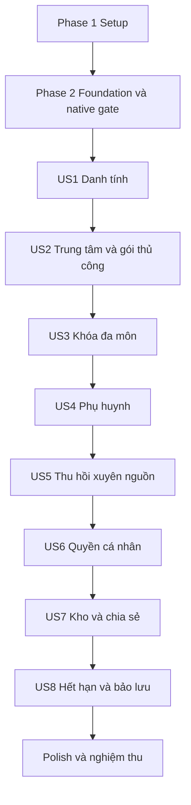

# Tasks: Bộ khung xác thực và phân quyền đa trung tâm Giáo Khoa

**Input**: [spec.md](spec.md), [plan.md](plan.md), [research.md](research.md), [data-model.md](data-model.md), [HTTP contract](contracts/http-api.md), [authorization contract](contracts/authorization.md), [quickstart.md](quickstart.md).

**Ngày tạo**: 2026-11-05. **Nhánh Git**: `main`. **Trạng thái**: Chưa thực hiện; mọi checkbox để trống. File này chỉ phân rã công việc, không là bằng chứng triển khai hoặc kiểm thử sản phẩm.

**Tests**: Có nhiệm vụ kiểm thử vì spec yêu cầu kiểm chứng quyết định quyền, ma trận nghiệm thu và hiệu lực thu hồi. Kiểm thử có ý nghĩa về hành vi/quyền; không tạo test cho thay đổi trình bày hoặc test chỉ lặp implementation. Đặt test/contract trước implementation trong mỗi story, kiểm tra red vì thiếu hành vi rồi green bằng code thật; native acceptance dùng Keycloak/PostgreSQL thật.

**Organization**: Phase 1 Setup → Phase 2 Foundation + native gate → US1…US8 đúng ưu tiên P1 trước P2 → Polish. Độc lập nghiệm thu nghĩa là có thể chuẩn bị fixtures tiền đề, không phải giả vờ không có phụ thuộc model/API giữa các story.

## Format: `[ID] [P?] [Story] Description`

- Mỗi nhiệm vụ có checkbox, ID liên tiếp, nhãn US khi thuộc story và đường dẫn file cụ thể.
- `[P]` chỉ là cơ hội làm đồng thời khi mọi phụ thuộc đã hoàn tất, các file không trùng; không có nghĩa bỏ qua checkpoint hoặc cho phép chạy hạ tầng/test phá DEV.
- Đường dẫn task tính từ repository root. Những file implementation chưa tồn tại là đích sẽ tạo; tài liệu tham chiếu tính từ feature directory.
- Model tasks chép nguyên văn field/ràng buộc từ data-model trong dấu «…»; áp dụng thêm các quy tắc chung UUID, UTC, immutable history, workspace/FK/RLS và state transitions ở model.
- Thao tác quyền luôn dùng cùng PEP/PAP/PDP. Không có role teacher/student toàn cục, custom-role editor, mandatory MFA, payment automation, full editor/grader hoặc API giả quyền actor.

## Phase 1: Setup — khởi tạo hai ứng dụng

**Mục tiêu**: Khởi tạo đúng stack, cấu hình và môi trường kiểm chứng; chưa mở rộng CRUD.

**Điều kiện ra**: Backend/Next build được, wrapper/lockfile cố định dependency, browser và backend truy cập cùng issuer, môi trường test tách DEV. T001/T002/T003 không dùng chung file và có thể thực hiện song song.

- [ ] T001 [P] Khởi tạo Spring Boot 4.1.2/Java 25 với Maven Wrapper; khai báo OAuth2 Client, Session JDBC, JPA, Flyway, Validation và test dependencies theo BOM; tạo package nghiệp vụ theo plan, không thêm PDP hoặc microservice. Đích: `backend/pom.xml`; `backend/mvnw`; `backend/.mvn/wrapper/maven-wrapper.properties`; `backend/src/main/java/com/giaokhoa/GiaoKhoaApplication.java`.
- [ ] T002 [P] Khởi tạo Next.js 16.4.5 App Router/TypeScript với npm lockfile; script dev/start port 3001, lint/test/build/E2E theo quickstart; layout tiếng Việt tối thiểu có lối đăng nhập, chưa thêm Auth.js/session thứ hai. Đích: `frontend/package.json`; `frontend/package-lock.json`; `frontend/tsconfig.json`; `frontend/src/app/layout.tsx`; `frontend/src/app/page.tsx`.
- [ ] T003 [P] Tạo mẫu biến môi trường shell-compatible cho compose/backend và mẫu Next chỉ BACKEND_INTERNAL_URL; bỏ secret khỏi Git và frontend; giữ cấu hình .devcontainer hiện có, mô tả runtime/migration/provisioner credential riêng. Đích: `.env.example`; `.gitignore`; `frontend/.env.local.example`; `backend/src/main/resources/application.yml`.
- [ ] T004 Thêm compose override gateway/Mailpit và môi trường test PostgreSQL 18.6–Keycloak 26.8.1; giữ app-db/keycloak-db riêng, đúng COMPOSE_PROJECT_NAME; giải quyết alias issuer host/container, port 3000/8081 và bỏ mapping Keycloak trùng gateway; không reset volume DEV. Đích: `infra/compose.dev.yaml`; `infra/compose.test.yaml`; `infra/gateway/Caddyfile`. Phụ thuộc: T003.
- [ ] T005 Cấu hình JUnit integration và Playwright Authorization Code thật, Testcontainers hoặc test services external; nhận mail test, realm/database riêng và cleanup chỉ tài sản test; không H2/mock PDP/password grant cho acceptance. Đích: `backend/src/test/java/com/giaokhoa/support/IntegrationEnvironment.java`; `backend/src/test/resources/application-integration.yml`; `frontend/playwright.config.ts`; `frontend/tests/e2e/support/test-environment.ts`. Phụ thuộc: T001, T002, T004.

## Phase 2: Foundational — cơ chế quyền và gate bắt buộc

**Mục tiêu**: Xây phần dùng chung tối thiểu và chứng minh native Keycloak trước mọi luồng CRUD mở rộng.

**Chặn toàn bộ user stories**: Chỉ chuyển Phase 3 sau T022 đạt và có bằng chứng. Gate dùng nguồn dữ kiện giả đã biết, resource thật trong realm test và chính PEP/PAP sẽ dùng trong vận hành; không dựng policy engine giả. Viết các phép thử gate trước hoàn thiện hành vi, xác nhận chúng thất bại vì thiếu hành vi cần thiết, không vì môi trường chưa khởi động.

**Bất biến chung**: ID nghiệp vụ UUID, Keycloak ID opaque; «Thời gian lưu UTC» và hiệu lực «[valid_from, expires_at)»; workspace keys/FK tổng hợp; không mật khẩu/token trong audit; migration role khác runtime không owner/BYPASSRLS. Constitution hiện là template, không tự ban hành nguyên tắc mới.

- [ ] T006 Tạo migration và entities directory dùng chung, gồm danh tính, workspace, center, membership/role và gói; FK/unique/check đủ theo model, một chủ sở hữu ban đầu; không triển khai CRUD ở đây. Chuẩn bị fixtures directory để từng story được nghiệm thu độc lập. Đích: `backend/src/main/resources/db/migration/V001__identity_workspace_directory.sql`; `backend/src/main/java/com/giaokhoa/identity/model/UserAccount.java`; `backend/src/main/java/com/giaokhoa/tenancy/model/Workspace.java`; `backend/src/main/java/com/giaokhoa/tenancy/model/Center.java`; `backend/src/main/java/com/giaokhoa/tenancy/model/CenterMembership.java`; `backend/src/main/java/com/giaokhoa/tenancy/model/MembershipRole.java`; `backend/src/main/java/com/giaokhoa/subscriptions/model/SubscriptionPeriod.java`. user_account: trường «`id`, `keycloak_sub`, `username`, `email?`, `email_verified`, `origin`, `identity_state`»; ràng buộc «Unique sub/username; origin `SELF_REGISTERED` hoặc `CENTER_ISSUED` do server xác lập, không có user_type teacher/student/parent toàn cục; email là thông tin đồng bộ, Keycloak là nguồn danh tính». workspace: trường «`id`, `kind`, `owner_user_id?`, `center_id?`, `state`»; ràng buộc «`PERSONAL` có đúng một owner; `CENTER` có đúng một center; `SYSTEM` không thuộc cá nhân/trung tâm; mỗi user có một personal workspace». center: trường «`id`, `workspace_id`, `keycloak_organization_id`, `name`, `owner_user_id`, `state`»; ràng buộc «Unique workspace/Organization; chủ sở hữu có membership hợp lệ; không tự chuyển chủ sở hữu ở bản đầu». center_membership: trường «`id`, `workspace_id`, `user_id`, `state`, `joined_at`, `revoked_at?`»; ràng buộc «Một quan hệ hiện hành mỗi user/workspace; danh tính tồn tại độc lập với membership». membership_role: trường «`membership_id`, `role`»; ràng buộc «Role cố định `OWNER`, `MANAGER`, `TEACHER`, `STUDENT`, `PARENT`; một membership có nhiều role; OWNER khớp center.owner_user_id; không nhận role ngoài danh mục». subscription_period: trường «`id`, `workspace_id`, `valid_from`, `expires_at`, `confirmation_ref`, `confirmed_by`, `confirmed_at`»; ràng buộc «Chỉ gói personal/center; thời gian kết thúc lớn hơn bắt đầu; xác nhận thủ công bởi platform operator; không có payment gateway hoặc giá gói trong bản đầu». Phụ thuộc: T005.
- [ ] T007 Tạo migration/entities revision, projection và durable operation; không thêm broker/outbox thứ hai, giữ operation trạng thái PENDING/APPLYING/SUCCEEDED/RETRYABLE_FAILURE/FAILED; READY chỉ khi revisions/hash/dependencies khớp. Đích: `backend/src/main/resources/db/migration/V002__authorization_control.sql`; `backend/src/main/java/com/giaokhoa/authorization/model/AuthorizationPartition.java`; `backend/src/main/java/com/giaokhoa/authorization/model/AuthorizationProjection.java`; `backend/src/main/java/com/giaokhoa/authorization/model/AuthorizationOperation.java`. authz_partition: trường «`id`, `kind`, `owner_key`, `desired_revision`, `applied_revision`, `state`»; ràng buộc «Kind `WORKSPACE`, `GRANT`, `ACCOUNT`; state `READY`, `PENDING`, `FAILED`; chỉ READY khi revisions bằng nhau; có row ngay khi tạo phạm vi». authz_projection: trường «`id`, `partition_id`, `target_key`, `keycloak_resource_id`, `policy_names`, `dependency_partition_ids`, `desired_hash`, `applied_hash`, `state`»; ràng buộc «Unique target_key; target gồm workspace/object/version/purpose; chỉ chứa locator/control metadata, không có body/điểm; không cấp quyền theo field này». authorization_operation: trường «`id`, `initiator_user_id`, `workspace_id?`, `idempotency_key`, `payload_hash`, `affected_partitions`, `desired_revision`, `state`, `attempt_count`, `next_attempt_at?`, `last_error_code?`»; ràng buộc «Vừa là operation status vừa là durable work queue trong Spring; không thêm bảng outbox thứ hai/broker; idempotency same key khác body trả conflict; không chứa secret/token». Phụ thuộc: T006.
- [ ] T008 Tạo schema Spring Session JDBC và OIDC correlation theo dependency thực; cấu hình HttpSessionOAuth2AuthorizedClientRepository để access/refresh token đi cùng session JDBC, không authorized-client mặc định in-memory; registry issuer/client/sub/sid/session_id tồn tại qua restart. Đích: `backend/src/main/resources/db/migration/V003__sessions_and_oidc_correlation.sql`; `backend/src/main/java/com/giaokhoa/identity/security/OidcSessionConfiguration.java`; `backend/src/main/java/com/giaokhoa/identity/security/JdbcOidcSessionRegistry.java`. Phụ thuộc: T006.
- [ ] T009 Cài Problem Details/error codes, field violations, idempotency payload hash và If-Match/428/409; audit chỉ actor/action/target/operation/outcome, không secret/nội dung riêng; thao tác pending không báo đã thành công. Đích: `backend/src/main/resources/db/migration/V004__audit_events.sql`; `backend/src/main/java/com/giaokhoa/shared/http/ProblemDetailsAdvice.java`; `backend/src/main/java/com/giaokhoa/authorization/operation/IdempotencyService.java`; `backend/src/main/java/com/giaokhoa/shared/audit/AuditEvent.java`. audit_event: trường «`id`, `actor_user_id?`, `workspace_id?`, `action`, `target_type`, `target_id`, `operation_id?`, `outcome`, `occurred_at`»; ràng buộc «Ghi biến động đặc quyền/gói/quan hệ/khôi phục và lỗi đồng bộ; không ghi password/token/body bài làm hoặc toàn bộ thông tin cá nhân». Phụ thuộc: T007.
- [ ] T010 Tạo baseline realm/clients và bootstrap idempotent: web confidential Code+PKCE, api Authorization Services Enforcing, provisioner riêng; không wildcard allow/Direct Access Grants/group claims; email optional, verifyEmail bật, không default VERIFY_EMAIL/UPDATE_PROFILE; Organization directory và realm groups theo authorization contract. Đích: `infra/keycloak/baseline/realm.json`; `infra/keycloak/bootstrap.sh`; `backend/src/main/java/com/giaokhoa/authorization/keycloak/KeycloakProvisioningClient.java`. Phụ thuộc: T004, T006.
- [ ] T011 Cài Spring OIDC session và cookie host-only/HttpOnly/Secure theo môi trường; CSRF cho browser mutations, POST logout; duy nhất inbound back-channel được miễn browser CSRF/session và xác minh signed logout_token đúng issuer/audience/events/correlation/cookie SESSION; không thêm public bearer API. Đích: `backend/src/main/java/com/giaokhoa/identity/security/SecurityConfiguration.java`; `backend/src/main/java/com/giaokhoa/identity/security/OidcLogoutConfiguration.java`. Phụ thuộc: T008, T010, T009.
- [ ] T012 Tạo client Next fetch same-origin với CSRF, no-store và xử lý 202/403/409/428/503; Server Components chỉ forward cookie đúng request; cấm token trong localStorage/SSR và không cache session/tenant/capability. Đích: `frontend/src/lib/api-client.ts`; `frontend/src/lib/server-api.ts`; `frontend/src/features/operations/operation-status.ts`. Phụ thuộc: T002, T011.
- [ ] T013 [P] Viết test native PDP mới mỗi resource/scope, giả role/group/claim không cấp quyền, batch chỉ một permission được cấp không thành ALL và gate thời gian half-open; dùng Keycloak thật và fixture cố định, không mock kết quả allow. Đích: `backend/src/test/java/com/giaokhoa/authorization/NativePermissionGateIT.java`; `backend/src/test/java/com/giaokhoa/authorization/NativeTimePolicyIT.java`; `infra/keycloak/fixtures/native-gate.json`. Phụ thuộc: T007, T010, T011.
- [ ] T014 [P] Viết test cùng session trước/sau revoke, ACCOUNT/WORKSPACE/GRANT PENDING, lỗi provision/crash/retry và concurrent revoke/write; dùng transaction PostgreSQL thật và policy graph thật. Đích: `backend/src/test/java/com/giaokhoa/authorization/ProjectionFenceGateIT.java`; `backend/src/test/java/com/giaokhoa/authorization/ConcurrentRevocationIT.java`. Phụ thuộc: T007, T010, T011.
- [ ] T015 Cài client UMA với token đúng user trong session; đúng một resource+scope mỗi call response_mode=decision; đòi đủ mọi cặp, không service-account evaluate thay user, không RPT/claim_token/cache allow; deny 403, không xác minh được quyết định 503. Đích: `backend/src/main/java/com/giaokhoa/authorization/decision/KeycloakDecisionClient.java`; `backend/src/main/java/com/giaokhoa/authorization/decision/RequiredPermissions.java`. Phụ thuộc: T013, T014.
- [ ] T016 Cài nguồn graph cố định: actor/current realm group/user, AND mandatory gates, OR nguồn độc lập và một root permission mỗi target/scope; ID projection có workspace/object/version/purpose; nguồn role tiền đề không là global role; dùng AND nbf=start POSITIVE và nbf=end NEGATIVE thay noa=end. Đích: `backend/src/main/java/com/giaokhoa/authorization/policy/PolicyGraph.java`; `backend/src/main/java/com/giaokhoa/authorization/policy/NativePolicyTemplates.java`; `backend/src/main/java/com/giaokhoa/authorization/policy/PolicyGraphWriter.java`. Phụ thuộc: T015.
- [ ] T017 Cài durable worker trong Spring: cập nhật desired state/PENDING, provision idempotent, xác minh graph/revision rồi READY/SUCCEEDED; retry giữ thứ tự revision/không mở fence khi hết số lần thử; Directory Admin edits ngoài luồng cần fence/reconcile. Đích: `backend/src/main/java/com/giaokhoa/authorization/operation/AuthorizationOperationService.java`; `backend/src/main/java/com/giaokhoa/authorization/projection/ProjectionWorker.java`; `backend/src/main/java/com/giaokhoa/authorization/projection/ProjectionReconciler.java`. Phụ thuộc: T016, T009.
- [ ] T018 Cài resolver manifest và transaction fence: luôn ACCOUNT actor + WORKSPACE đích + closure source GRANT/WORKSPACE; khóa ổn định, re-resolve nếu closure đổi, giữ revision đến commit/materialize DTO; không giữ transaction khi chờ worker mạng, PENDING/FAILED 503. Đích: `backend/src/main/java/com/giaokhoa/authorization/fence/AuthorizationFence.java`; `backend/src/main/java/com/giaokhoa/authorization/fence/DependencyManifestResolver.java`; `backend/src/main/java/com/giaokhoa/authorization/decision/ProtectedActionExecutor.java`. Phụ thuộc: T017.
- [ ] T019 Cài identity eligibility gate: unknown là SELF_REGISTERED, CENTER_ISSUED chỉ record backend tạo; đọc profile hiện hành qua Admin API làm input, đồng bộ account partition nếu đổi; email_verified/role/origin do browser hoặc token cũ không đủ, lỗi đọc identity fail-closed. Đích: `backend/src/main/java/com/giaokhoa/identity/eligibility/IdentityEligibilitySynchronizer.java`; `backend/src/main/java/com/giaokhoa/identity/keycloak/CurrentIdentityClient.java`. Phụ thuộc: T018.
- [ ] T020 Cài transaction workspace context/RLS helpers và metadata locators: thiếu workspace không thấy tenant rows, không trả content từ lookup trước PDP; scope enums/mapping tập trung, controller không tự allow theo role. Đích: `backend/src/main/java/com/giaokhoa/tenancy/data/WorkspaceTransaction.java`; `backend/src/main/java/com/giaokhoa/authorization/target/TargetLocator.java`; `backend/src/main/java/com/giaokhoa/authorization/permission/PermissionCatalog.java`. Phụ thuộc: T019.
- [ ] T021 Cài GET operation status cho initiator, review fixtures chỉ test/review và gate diagnostics không secret; fixture endpoints dùng SecurityContext actor và production PEP/PAP, không nhận người dùng thay thế hoặc expectedAllow. Đích: `backend/src/main/java/com/giaokhoa/authorization/operation/OperationController.java`; `backend/src/test/java/com/giaokhoa/support/NativeGateFixture.java`; `frontend/tests/e2e/native-gate.spec.ts`. Phụ thuộc: T020, T012.
- [ ] T022 Chạy/ghi bằng chứng gate native trước mở rộng: Code login qua UI thật, same-session revoke A/B, đúng con/published, partial permissions, UTC before/end/after, expired completion và source revoke qua fork, no-email/verified và lỗi/crash/cạnh tranh. Dữ kiện semantic giả được provision qua chính graph writer; có case không đạt thì dừng, không giảm spec/đổi PDP. Đích: `backend/src/test/java/com/giaokhoa/authorization/NativeGateAcceptanceIT.java`; `frontend/tests/e2e/native-gate.spec.ts`; `specs/001-multitenant-access/validation/native-gate.md`. Phụ thuộc: T021.

## Phase 3: US1 — Một tài khoản dùng ở nhiều không gian (P1, MVP)

**Mục tiêu**: Đăng ký/xác minh/đăng nhập, chuyển không gian, cấp danh tính học sinh và khôi phục tập trung; quyền nền practice mẫu không cần gói author.

**Independent Test**: Dùng fixtures directory A/B, operator và nguồn hệ thống đã phát hành; nghiệm thu US1.1–US1.9/T1–T2 mà không cần UI quản trị center của US2. Không cần đề thật hoặc module chia sẻ hoàn chỉnh.

**Trước triển khai**: Viết T023/T024, xác nhận red có ý nghĩa rồi mới hoàn thiện model/service/UI. **Checkpoint**: Cùng account chuyển A/B đúng quyền, không email không bị ép bổ sung, khôi phục không cấp lại mật khẩu cho quản lý.

- [ ] T023 [P] [US1] Viết integration/contract tests đủ US1.1–US1.9: xác minh, neutral baseline, opposite roles, issued không email, invite existing không đổi origin, current-email đổi làm mất eligibility, recovery và authentication lỗi. Đích: `backend/src/test/java/com/giaokhoa/identity/IdentityFlowIT.java`; `backend/src/test/java/com/giaokhoa/identity/RecoveryFlowIT.java`. Phụ thuộc: T022.
- [ ] T024 [P] [US1] Viết E2E Code login/verify mail/đổi temporary password/workspace switch/logout/back-channel/restart; kiểm tra DOM/network/SSR không có token, no-store và CSRF; chưa có action mới khi unverified. Đích: `frontend/tests/e2e/identity.spec.ts`; `frontend/tests/e2e/session-security.spec.ts`. Phụ thuộc: T022.
- [ ] T025 [P] [US1] Tạo migration/entity recovery_request và source origin khi cấp account, record phục vụ verification tối thiểu; schema giữ trạng thái REQUESTED/VERIFIED/RESOLVED/REJECTED. Đích: `backend/src/main/resources/db/migration/V005__identity_recovery.sql`; `backend/src/main/java/com/giaokhoa/identity/model/RecoveryRequest.java`. recovery_request: trường «`id`, `requester_user_id`, `workspace_id?`, `target_user_id`, `state`, `verified_by?`, `resolved_at?`, `verification_note?`»; ràng buộc «Chỉ platform operator xử lý tài khoản không email; ghi chú tối thiểu, không đính kèm tài liệu cá nhân trong tính năng này; không trả mật khẩu cho quản lý trung tâm». Phụ thuộc: T023, T024.
- [ ] T026 [P] [US1] Tạo primitives canonical resource/version cho quyền nền và dùng lại ở US7; body/answer stub tách DTO/scope, không xây editor hoặc API list content toàn hệ thống. Đích: `backend/src/main/resources/db/migration/V006__resource_primitives.sql`; `backend/src/main/java/com/giaokhoa/resources/model/Resource.java`; `backend/src/main/java/com/giaokhoa/resources/model/ResourceVersion.java`. resource: trường «`id`, `owner_workspace_id`, `created_by_user_id`, `kind`, `subject_id`, `state`»; ràng buộc «Owner bất biến trong thao tác thường; kind mẫu tương ứng câu hỏi/đề/ma trận; created_by không tự là nguồn quyền của tài nguyên center». resource_version: trường «`id`, `resource_id`, `version_no`, `label`, `body_stub`, `answer_stub?`, `review_state`, `locked_at?`»; ràng buộc «Unique resource/version_no; V1 đã lưu/giao không bị sửa tại chỗ; body/answer chỉ dữ liệu giả để xét quyền; câu trả lời có scope riêng». Phụ thuộc: T023, T024.
- [ ] T027 [US1] Tạo lịch sử practice mẫu riêng personal workspace với RLS; không tạo class/course/enrollment giả hoặc role student toàn cục để cho user mới luyện tập. Đích: `backend/src/main/resources/db/migration/V007__system_practice_history.sql`; `backend/src/main/java/com/giaokhoa/verification/model/SystemPracticeAttemptSample.java`. system_practice_attempt_sample: trường «`id`, `personal_workspace_id`, `user_id`, `system_resource_id`, `version_id`, `attempted_at`, `content_stub`, `outcome_stub?`»; ràng buộc «Quyền nền cho user eligible, không cần enrollment hoặc gói author; chỉ resource hệ thống phát hành để practice; lịch sử thuộc người làm, không tạo role học sinh toàn cục và không trộn vào kết quả center». Phụ thuộc: T026.
- [ ] T028 [US1] Cài bootstrap profile/user/personal workspace, nguồn eligible theo identity hiện hành; WorkspaceDirectory trả chỉ nơi hợp lệ, CurrentUser không suy nghề nghiệp từ role tổng; không xóa danh tính khi rời một center. Đích: `backend/src/main/java/com/giaokhoa/identity/IdentityService.java`; `backend/src/main/java/com/giaokhoa/tenancy/WorkspaceDirectory.java`; `backend/src/main/java/com/giaokhoa/identity/IssuedStudentRegistrar.java`. Phụ thuộc: T025.
- [ ] T029 [US1] Cài workflow gửi yêu cầu hỗ trợ đúng phạm vi và operator xác minh/resolve; center không reset existing identity; cấp student mới có temporary credential một lần, cập nhật origin bằng server, lỗi sau identity-create phải reconcile an toàn. Đích: `backend/src/main/java/com/giaokhoa/identity/RecoveryService.java`; `backend/src/main/java/com/giaokhoa/identity/InitialCredentialHandoff.java`. Phụ thuộc: T028.
- [ ] T030 [US1] Expose session/CSRF, me workspaces/history/operations, identity verification, recovery request và platform recovery list/resolve theo HTTP contract; callback/logout do Spring xử lý; response không có bearer token hoặc secret ở poll/retry. Đích: `backend/src/main/java/com/giaokhoa/identity/SessionController.java`; `backend/src/main/java/com/giaokhoa/identity/RecoveryController.java`; `backend/src/main/java/com/giaokhoa/verification/SystemPracticeService.java`. Phụ thuộc: T029, T027.
- [ ] T031 [P] [US1] Xây onboarding xác minh/khôi phục, workspace switcher và session state đúng request; lấy CSRF lại sau login/logout, không cache/giữ trạng thái của workspace cũ; UI chưa eligible không lộ metadata center. Đích: `frontend/src/app/onboarding/page.tsx`; `frontend/src/features/identity/session-provider.tsx`; `frontend/src/features/identity/workspace-switcher.tsx`. Phụ thuộc: T024.
- [ ] T032 [US1] Xây trang platform recovery và lịch sử practice mẫu/neutral personal landing; operator không xem content học tập từ chức vụ, không tạo gói hoặc lớp khi chỉ có quyền nền. Đích: `frontend/src/app/platform/recovery-requests/page.tsx`; `frontend/src/app/personal/page.tsx`; `frontend/src/features/identity/recovery-request-form.tsx`. Phụ thuộc: T031.
- [ ] T033 [US1] Chạy các test US1 đã viết và ghi minh chứng 9 scenarios, restart giữ session+authorized client+OIDC correlation; không đánh dấu story hoàn tất nếu issued student phải email hoặc baseline mở author/student role. Đích: `specs/001-multitenant-access/validation/us1.md`. Phụ thuộc: T030, T032.

## Phase 4: US2 — Khởi tạo và quản trị trung tâm (P1)

**Mục tiêu**: Operator tạo tenant/gói, owner quản lý manager và thành viên; teacher không tạo lớp center.

**Independent Test**: Tạo center mới với các account có sẵn của fixture US1; nghiệm thu US2.1–US2.7/T3 bằng native policies và resource stub; không cần lịch học hoặc editor.

**Checkpoint**: Không tự tạo tenant, không custom-role, đúng owner/manager, cấp student là create mới chứ không reset danh tính có sẵn.

- [ ] T034 [P] [US2] Viết contract/integration tests tenant/owner/manager/member/invite/student-issue/subscription manual, role additions/removals scope riêng, no-email handoff chỉ CREATE, username trùng không chiếm user và admin không tự đọc private content. Đích: `backend/src/test/java/com/giaokhoa/tenancy/CenterAdministrationIT.java`; `backend/src/test/java/com/giaokhoa/tenancy/MembershipInvitationIT.java`. Phụ thuộc: T033.
- [ ] T035 [P] [US2] Viết E2E operator tạo center/confirm period, owner bổ nhiệm manager, manager mời/cấp student và trạng thái 202; verify bí mật không xuất hiện ở SSR/status/list/retry. Đích: `frontend/tests/e2e/center-administration.spec.ts`. Phụ thuộc: T033.
- [ ] T036 [US2] Tạo migration/entity invitation; membership và center dùng lại model foundation; cấm OWNER trong invite, MANAGER cần owner, không đổi origin của account được mời. Đích: `backend/src/main/resources/db/migration/V008__center_invitations.sql`; `backend/src/main/java/com/giaokhoa/tenancy/model/Invitation.java`. invitation: trường «`id`, `workspace_id`, `target_email?`, `target_user_id?`, `token_hash`, `intended_roles`, `expires_at`, `state`»; ràng buộc «Token một lần; không lưu token thô; người chấp nhận phải đúng sub đích hoặc chứng minh email đích đã xác minh; tên trùng không đủ ghép tài khoản». Phụ thuộc: T034, T035.
- [ ] T037 [US2] Cài tạo center/Organization, owner membership và native source projection qua operation/revision; replay không tạo hai tenant hoặc hai owner; role management chỉ đúng workspace, không remove owner cuối. Đích: `backend/src/main/java/com/giaokhoa/tenancy/CenterService.java`; `backend/src/main/java/com/giaokhoa/tenancy/CenterPolicyProjector.java`. Phụ thuộc: T036.
- [ ] T038 [US2] Cài invite/accept/roles/revoke/student issue qua IssuedStudentRegistrar; prereq role nguồn giữ ràng buộc dependent sources, nhiều role không cộng thành global allow; thu hồi vẫn được khi gói hết hạn. Đích: `backend/src/main/java/com/giaokhoa/tenancy/MembershipService.java`; `backend/src/main/java/com/giaokhoa/tenancy/InvitationService.java`; `backend/src/main/java/com/giaokhoa/tenancy/MembershipPolicyProjector.java`. Phụ thuộc: T037.
- [ ] T039 [US2] Cài xác nhận kỳ/gia hạn thủ công bởi operator, kiểm tra end > start và native time policy; lưu confirmationRef/audit, không payment automation/giá gói; không tự phục hồi nguồn đã revoke. Đích: `backend/src/main/java/com/giaokhoa/subscriptions/SubscriptionService.java`; `backend/src/main/java/com/giaokhoa/subscriptions/SubscriptionPolicyProjector.java`. Phụ thuộc: T038.
- [ ] T040 [US2] Expose platform centers/subscriptions và center membership/invitations/roles/student APIs theo hợp đồng; StudentIssueView có handoff chỉ response CREATE đầu, status/retry không secret; batch role đòi đủ scopes phần thêm/gỡ và không báo completed sớm. Đích: `backend/src/main/java/com/giaokhoa/tenancy/CenterController.java`; `backend/src/main/java/com/giaokhoa/tenancy/MembershipController.java`; `backend/src/main/java/com/giaokhoa/subscriptions/SubscriptionController.java`. Phụ thuộc: T039.
- [ ] T041 [P] [US2] Xây platform centers/confirm package và center members/invites/role editor danh mục cố định; ẩn chức năng theo capability nhưng backend xét lại; hiện pending/failed/succeeded và credential-create một lần an toàn. Đích: `frontend/src/app/platform/page.tsx`; `frontend/src/app/centers/[workspaceId]/members/page.tsx`; `frontend/src/features/tenancy/center-administration.tsx`. Phụ thuộc: T035.
- [ ] T042 [US2] Nghiệm thu 7 scenarios US2, chéo role A/B, operator không có academic wildcard và teacher không tạo lớp center; ghi source IDs/revision/bằng chứng không secret. Đích: `specs/001-multitenant-access/validation/us2.md`. Phụ thuộc: T040, T041.

## Phase 5: US3 — Khóa đa môn, nhiều giáo viên, ghi danh từng môn (P1)

**Mục tiêu**: Quản lý lớp/khóa/môn/roster/phân công thực tế, quyền giảng dạy/giao bài theo từng môn.

**Independent Test**: Dùng center/owner/manager đã chuẩn bị, tạo L1/L2 và K ba môn; nghiệm thu US3.1–US3.8/T4–T5, mock nội dung đề bằng canonical stub US1 nhưng gọi PDP thật.

**Checkpoint**: Một khóa một lớp; thêm môn không tự ghi danh; hai giáo viên cùng môn; homeroom chỉ giao đề đã duyệt/track, không tự chấm/xem đáp án.

- [ ] T043 [P] [US3] Viết tests lớp–khóa–môn/roster/ghi danh/phân công, FK chéo workspace/lớp, 3 môn–2 giáo viên, học sinh chọn môn, all-current không all-future và teacher/homeroom forbidden scopes. Đích: `backend/src/test/java/com/giaokhoa/teaching/TeachingStructureIT.java`; `backend/src/test/java/com/giaokhoa/teaching/TeachingAuthorizationIT.java`. Phụ thuộc: T042.
- [ ] T044 [P] [US3] Viết E2E quản lý tạo lớp/khóa nhiều môn, chọn môn ghi danh, nhiều giáo viên, homeroom và actor chuyển lớp/môn không lộ dữ liệu. Đích: `frontend/tests/e2e/teaching-administration.spec.ts`. Phụ thuộc: T042.
- [ ] T045 [P] [US3] Tạo schema/models school_class/class_student có composite workspace FK, active uniqueness và RLS; không xóa lớp/roster làm mất lịch sử. Đích: `backend/src/main/resources/db/migration/V009__classes_and_roster.sql`; `backend/src/main/java/com/giaokhoa/teaching/model/SchoolClass.java`; `backend/src/main/java/com/giaokhoa/teaching/model/ClassStudent.java`. school_class: trường «`id`, `workspace_id`, `name`, `state`»; ràng buộc «Tạo trong center cần owner/manager; tạo personal cần gói; khác workspace không chia sẻ class». class_student: trường «`id`, `workspace_id`, `class_id`, `student_user_id`, `state`, `revoked_at?`»; ràng buộc «Unique class/student hiện hành; center student cần membership tương ứng; dữ liệu lịch sử còn tham chiếu». Phụ thuộc: T043, T044.
- [ ] T046 [P] [US3] Tạo model/danh mục subject tối thiểu từ seed có kiểm soát, không cây chương trình hoặc taxonomy mới; endpoint danh mục không mang dữ liệu riêng. Đích: `backend/src/main/resources/db/migration/V010__subjects.sql`; `backend/src/main/java/com/giaokhoa/teaching/model/Subject.java`. subject: trường «`id`, `code`, `name`, `state`»; ràng buộc «Danh mục môn tham chiếu tối thiểu; mã duy nhất; không xây cây chương trình GDPT hoặc taxonomy đầy đủ». Phụ thuộc: T043, T044.
- [ ] T047 [US3] Tạo course/course_subject với lớp/workspace thống nhất, danh sách môn không rỗng và FK tổng hợp; một môn trong hai khóa có identity phạm vi khác. Đích: `backend/src/main/resources/db/migration/V011__courses_and_subjects.sql`; `backend/src/main/java/com/giaokhoa/teaching/model/Course.java`; `backend/src/main/java/com/giaokhoa/teaching/model/CourseSubject.java`. course: trường «`id`, `workspace_id`, `class_id`, `name`, `state`»; ràng buộc «Chính xác một lớp cùng workspace; chưa có khóa gom nhiều lớp». course_subject: trường «`id`, `workspace_id`, `class_id`, `course_id`, `subject_id`, `state`»; ràng buộc «Unique course/subject hiện hành; composite FK kiểm tra course thuộc class; cùng môn ở hai khóa là hai phạm vi quyền». Phụ thuộc: T045, T046.
- [ ] T048 [US3] Tạo enrollment, teaching/homeroom assignments và RLS/composite constraints; thêm/gỡ nguồn không dùng cùng scope để vượt policy gói. Đích: `backend/src/main/resources/db/migration/V012__enrollments_and_assignments.sql`; `backend/src/main/java/com/giaokhoa/teaching/model/Enrollment.java`; `backend/src/main/java/com/giaokhoa/teaching/model/TeachingAssignment.java`; `backend/src/main/java/com/giaokhoa/teaching/model/HomeroomAssignment.java`. enrollment: trường «`id`, `workspace_id`, `class_student_id`, `course_subject_id`, `state`»; ràng buộc «Hai phía cùng lớp/workspace; unique cặp hiện hành; ghi danh tất cả chỉ tạo cho môn được chọn lúc thao tác». teaching_assignment: trường «`id`, `workspace_id`, `course_subject_id`, `teacher_user_id`, `state`»; ràng buộc «Nhiều giáo viên cùng course_subject, một giáo viên nhiều course_subject; unique cặp hiện hành». homeroom_assignment: trường «`id`, `workspace_id`, `class_id`, `teacher_user_id`, `state`»; ràng buộc «Gắn lớp, không gắn mọi môn như quyền chấm; actor là thành viên hợp lệ; tránh nguồn phân công trùng». Phụ thuộc: T047.
- [ ] T049 [US3] Cài lớp/roster/course/subject services và scoped repositories; candidate metadata chưa có payload, class read không tự cho whole roster; gói hết hạn chặn mở rộng, revoke bảo lưu lịch sử. Đích: `backend/src/main/java/com/giaokhoa/teaching/ClassService.java`; `backend/src/main/java/com/giaokhoa/teaching/CourseService.java`; `backend/src/main/java/com/giaokhoa/teaching/data/TeachingRepository.java`. Phụ thuộc: T048.
- [ ] T050 [US3] Cài batch enrollment và teacher/homeroom sources với prereq role đúng center; khi gỡ role/class_student đóng/revoke dependent assignment/enrollment trong cùng revision, không tái sinh ngầm; group policy đọc membership hiện hành. Đích: `backend/src/main/java/com/giaokhoa/teaching/EnrollmentService.java`; `backend/src/main/java/com/giaokhoa/teaching/AssignmentService.java`; `backend/src/main/java/com/giaokhoa/teaching/TeachingPolicyProjector.java`; `backend/src/main/java/com/giaokhoa/teaching/TeachingRevocationContributor.java`. Phụ thuộc: T049.
- [ ] T051 [US3] Expose đầy đủ class/course/subject/roster/enrollment/teacher/homeroom routes; validate class membership, đúng môn và mọi cặp bắt buộc; không nhận actor override; chỉ list rows có quyền và không leak totalCount. Đích: `backend/src/main/java/com/giaokhoa/teaching/ClassController.java`; `backend/src/main/java/com/giaokhoa/teaching/CourseController.java`; `backend/src/main/java/com/giaokhoa/teaching/EnrollmentController.java`; `backend/src/main/java/com/giaokhoa/teaching/AssignmentController.java`. Phụ thuộc: T050.
- [ ] T052 [P] [US3] Xây UI class/course/môn/roster/ghi danh/phân công, checkbox chọn các môn hiện có và nhiều giáo viên; hiển thị context lớp–khóa–môn rõ, không lộ native policy/revision cho người dùng. Đích: `frontend/src/app/centers/[workspaceId]/classes/page.tsx`; `frontend/src/features/teaching/class-management.tsx`; `frontend/src/features/teaching/course-subject-editor.tsx`; `frontend/src/features/teaching/enrollment-editor.tsx`. Phụ thuộc: T044.
- [ ] T053 [US3] Chạy đầy đủ US3.1–US3.8 và raw-query RLS/FK tests, giáo viên chỉ roster môn phụ trách, current/future subject và class khác; ghi minh chứng trước bật luồng parent. Đích: `specs/001-multitenant-access/validation/us3.md`. Phụ thuộc: T051, T052.

## Phase 6: US4 — Phụ huynh xem kết quả của đúng con (P1)

**Mục tiêu**: Parent request, owner/manager duyệt/gỡ; hiển thị chỉ kết quả đã công bố của con trong đúng center.

**Independent Test**: Seed activities/submissions/results giả có quan hệ hợp lệ với lớp US3 và resource stub US1; nghiệm thu US4.1–US4.5/T6. Không phụ thuộc editor/chấm bài thật hoặc các action chia sẻ của US7.

**Checkpoint**: Pending link, homeroom-only, child khác, center khác và DRAFT đều bị chặn; DTO không chứa bài làm/đáp án.

- [ ] T054 [P] [US4] Viết contract/integration tests approved/pending/revoked link, wrong child/center, parent role chỉ xem published, homeroom không duyệt, list không lộ hidden fields/tổng hàng; cùng session sau gỡ bị chặn. Đích: `backend/src/test/java/com/giaokhoa/guardians/GuardianAccessIT.java`; `backend/src/test/java/com/giaokhoa/guardians/PublishedResultContractIT.java`. Phụ thuộc: T053.
- [ ] T055 [P] [US4] Viết E2E parent gửi request, manager approve, parent xem đúng con; đổi URL sid/wid, API query và back navigation không lấy dữ liệu khác hoặc draft. Đích: `frontend/tests/e2e/guardian-results.spec.ts`. Phụ thuộc: T053.
- [ ] T056 [US4] Tạo guardian_link schema/model/RLS, trạng thái REQUESTED/APPROVED/REJECTED/REVOKED và nguồn parent role; request tự thân không mở quyền. Đích: `backend/src/main/resources/db/migration/V013__guardian_links.sql`; `backend/src/main/java/com/giaokhoa/guardians/model/GuardianLink.java`. guardian_link: trường «`id`, `workspace_id`, `parent_user_id`, `student_user_id`, `state`, `requested_by`, `approved_by?`, `approved_at?`, `revoked_at?`»; ràng buộc «Actor parent hiện hành trong center khi được duyệt; child thuộc phạm vi center; chỉ owner/manager duyệt; không đồng nhất với quan hệ gia đình toàn nền tảng». Phụ thuộc: T054, T055.
- [ ] T057 [US4] Tạo primitive sample_activity/submission/result đủ FK/UTC/snapshot và RLS phục vụ read side; dữ liệu giả seed qua test/review, chưa triển khai workflow soạn/làm/chấm đề đầy đủ. Đích: `backend/src/main/resources/db/migration/V014__learning_samples.sql`; `backend/src/main/java/com/giaokhoa/verification/model/SampleActivity.java`; `backend/src/main/java/com/giaokhoa/verification/model/SampleSubmission.java`; `backend/src/main/java/com/giaokhoa/verification/model/SampleResult.java`. sample_activity: trường «`id`, `workspace_id`, `course_subject_id`, `resource_id`, `version_id`, `assigned_by`, `assigned_at`, `due_at`, `attempt_limit`, `subscription_period_id`, `state`»; ràng buộc «Đúng subject; cần target assign và quyền dùng version; snapshot lịch/period/attempt trước hết hạn; state `ASSIGNED`, `CLOSED`, `ARCHIVED`; không là trình giao đề thật». sample_submission: trường «`id`, `workspace_id`, `activity_id`, `student_user_id`, `attempt_no`, `submitted_at`, `content_stub`, `state`»; ràng buộc «Đúng học sinh ghi danh/đúng hoạt động; unique activity/student/attempt; không tăng số lượt sau hết hạn theo đường hoàn tất». sample_result: trường «`id`, `workspace_id`, `submission_id`, `student_user_id`, `course_subject_id`, `score_stub?`, `comment_stub?`, `state`, `published_at?`, `graded_by?`»; ràng buộc «State `DRAFT` hoặc `PUBLISHED`; chỉ parent scope trên PUBLISHED; teacher chuyên môn được grade/publish theo assignment còn hiệu lực; subject/student suy ra từ submission, không tin body tự khai». Phụ thuộc: T056.
- [ ] T058 [US4] Cài request/approve/reject/revoke và current native guardian group theo student+center, manager/owner gate; role PARENT prerequisite, không global family link; gỡ role/link đóng nguồn trong cùng revision. Đích: `backend/src/main/java/com/giaokhoa/guardians/GuardianLinkService.java`; `backend/src/main/java/com/giaokhoa/guardians/GuardianPolicyProjector.java`; `backend/src/main/java/com/giaokhoa/guardians/GuardianRevocationContributor.java`. Phụ thuộc: T057.
- [ ] T059 [US4] Cài read side kết quả và ResultPolicyProjector: scope published tách read/grade, source teacher/personal owner/enrolled student/approved guardian khác nhau; từng row phải đủ quyền; chỉ DTO PublishedResultView cho parent. Đích: `backend/src/main/java/com/giaokhoa/guardians/PublishedResultService.java`; `backend/src/main/java/com/giaokhoa/verification/ResultPolicyProjector.java`; `backend/src/main/java/com/giaokhoa/guardians/PublishedResultView.java`. Phụ thuộc: T058.
- [ ] T060 [US4] Expose guardian request/list/decision/revoke và students/{sid}/results; REQUESTED không cho read, không cho override parent/approver, list chỉ own request hoặc quản lý cần duyệt. Đích: `backend/src/main/java/com/giaokhoa/guardians/GuardianLinkController.java`; `backend/src/main/java/com/giaokhoa/guardians/StudentResultController.java`. Phụ thuộc: T059.
- [ ] T061 [P] [US4] Xây parent request và manager review, trang kết quả con chỉ published; không có tab bài làm/đáp án từ role parent, không render data cũ sau revoke/context change. Đích: `frontend/src/app/centers/[workspaceId]/guardian-links/page.tsx`; `frontend/src/app/centers/[workspaceId]/children/[studentId]/results/page.tsx`; `frontend/src/features/guardians/guardian-link-review.tsx`. Phụ thuộc: T055.
- [ ] T062 [US4] Nghiệm thu 5 scenarios US4 và T6 bằng parent thật trong realm test; lưu bằng chứng denial/response shape/first request after unlink và không lộ dữ liệu ngoài thẩm quyền. Đích: `specs/001-multitenant-access/validation/us4.md`. Phụ thuộc: T060, T061.

## Phase 7: US5 — Thu hồi quyền và ngăn vượt phạm vi (P1)

**Mục tiêu**: Hoàn thiện kiểm chứng thu hồi xuyên các nguồn đã vận hành; không phải đợi US5 mới bảo vệ các API trước đó. Core fence/revoke đã có ở Phase 2 và từng projector của US2–US4.

**Independent Test**: Giữ session cũ, gỡ role/membership/enrollment/guardian/phân công với A/B và nguồn độc lập; nghiệm thu US5.1–US5.6/T7/T13. Share dependencies bổ sung tại US7 và chạy lại cùng suite.

**Checkpoint**: Không báo hoàn tất sớm, không stale write sau revoke, ACCOUNT pending chặn mọi nghiệp vụ actor, A revoke không fence toàn tài khoản gây mất B.

- [ ] T063 [P] [US5] Viết ma trận integration 6 scenarios US5 gồm old cookie/token, actor/tenant/owner giả, independent OR sources, account-vs-workspace fence, lỗi directory/graph/commit và cạnh tranh multi-partition. Đích: `backend/src/test/java/com/giaokhoa/authorization/RevocationMatrixIT.java`; `backend/src/test/java/com/giaokhoa/authorization/ProjectionRecoveryIT.java`. Phụ thuộc: T062.
- [ ] T064 [P] [US5] Viết E2E giữ nguyên browser context, manager khác revoke rồi gọi lại; operator/workspace switch không dùng UI cache hoặc hidden button làm authorization, 202 không hiện thành công. Đích: `frontend/tests/e2e/revocation.spec.ts`. Phụ thuộc: T062.
- [ ] T065 [US5] Hoàn thiện coordinator dependency closure cho role/membership/class/assignment/enrollment/guardian, hooks nguồn đồng bộ trong desired mutation; khóa/revision theo contract, thu hồi source chính xác và bảo lưu nguồn độc lập. Đích: `backend/src/main/java/com/giaokhoa/authorization/projection/SourceRevocationCoordinator.java`; `backend/src/main/java/com/giaokhoa/authorization/fence/DependencyManifestResolver.java`. Phụ thuộc: T063, T064.
- [ ] T066 [US5] Hoàn thiện crash recovery/reconcile/operation status và retry ordering, fault injection chỉ test; không tự mở FAILED fence hoặc success khi native graph còn revision cũ; console emergency cần explicit reconcile. Đích: `backend/src/main/java/com/giaokhoa/authorization/projection/ProjectionReconciler.java`; `backend/src/test/java/com/giaokhoa/support/ProjectionFaultInjection.java`. Phụ thuộc: T065.
- [ ] T067 [US5] Hoàn thiện xử lý pending/error và refresh capabilities theo request sau mutation; xóa state riêng khi đổi workspace/logout, không giữ stale result/permission trong Next cache. Đích: `frontend/src/features/operations/operation-status.ts`; `frontend/src/features/identity/session-provider.tsx`; `frontend/src/lib/api-client.ts`. Phụ thuộc: T066.
- [ ] T068 [US5] Chạy core gate hồi quy và revoke matrix/E2E, ghi bằng chứng thứ tự quyết định–commit–revoke và không actor override; source share còn được mở rộng ở US7, không coi chưa triển khai share là test đã pass. Đích: `specs/001-multitenant-access/validation/us5.md`. Phụ thuộc: T067.

## Phase 8: US6 — Tách quyền cá nhân khỏi quyền trung tâm (P1)

**Mục tiêu**: Gói cá nhân mở kho/lớp personal; membership center không thay gói, gói personal không thay quyền center.

**Independent Test**: Ba account chỉ personal, chỉ center, có cả hai; dùng lớp/roster/khóa và resource stub đã có; nghiệm thu US6.1–US6.5/T3. Không cần module sharing hoàn chỉnh.

**Checkpoint**: Center teacher không gói vẫn làm việc được theo phân công; lớp personal dùng owner/enrollment, không tạo center_membership hoặc role nghề nghiệp toàn cục.

- [ ] T069 [P] [US6] Viết test 5 scenarios US6 và personal teaching branch: create/new cần gói, submit theo enrollment, owner grade/publish, rời center không mất personal; chưa mua gói vẫn practice, membership không mở author. Đích: `backend/src/test/java/com/giaokhoa/subscriptions/PersonalEntitlementIT.java`; `backend/src/test/java/com/giaokhoa/teaching/PersonalClassAuthorizationIT.java`. Phụ thuộc: T068.
- [ ] T070 [P] [US6] Viết E2E personal/center capability matrix, mua gói do operator kích hoạt, teacher không gói, personal owner tổ chức lớp/khóa/roster, không hiện editor học liệu chưa triển khai. Đích: `frontend/tests/e2e/personal-entitlements.spec.ts`. Phụ thuộc: T068.
- [ ] T071 [US6] Bổ sung personal policy sources theo owner+gói, current enrollment và completion; namespace/dữ kiện riêng center, không teacher/manager role toàn cục; re-use SubscriptionPolicyProjector đã có, không một engine quyền khác. Đích: `backend/src/main/java/com/giaokhoa/subscriptions/PersonalEntitlementProjector.java`; `backend/src/main/java/com/giaokhoa/teaching/PersonalTeachingPolicyProjector.java`. Phụ thuộc: T069, T070.
- [ ] T072 [US6] Tích hợp personal workspace vào lớp/khóa/roster/ghi danh và soạn sample resource; chỉ personal owner tổ chức, không mời đồng giáo viên; không đòi center membership cho học sinh personal. Đích: `backend/src/main/java/com/giaokhoa/teaching/PersonalClassService.java`; `backend/src/main/java/com/giaokhoa/resources/PersonalResourceService.java`. Phụ thuộc: T071.
- [ ] T073 [P] [US6] Xây personal classes UI tái dùng teaching components theo capability, trạng thái gói và kho mẫu; không copy role center sang personal và không giả có trình soạn đề. Đích: `frontend/src/app/personal/classes/page.tsx`; `frontend/src/features/subscriptions/personal-entitlements.tsx`; `frontend/src/app/personal/page.tsx`. Phụ thuộc: T070.
- [ ] T074 [US6] Nghiệm thu US6.1–US6.5, personal student/organizer hoạt động không center membership và tách owner/creator; kiểm tra activation/gia hạn không tự resurrect role/link/assignment đã gỡ. Đích: `specs/001-multitenant-access/validation/us6.md`. Phụ thuộc: T072, T073.

## Phase 9: US7 — Kho, phiên bản và chia sẻ tài nguyên (P2)

**Mục tiêu**: Quyền tài nguyên ba không gian, lưu ID/phiên bản nguồn, fork, hai kiểu chia sẻ, source dependencies và đính chính, tất cả bằng metadata/stub.

**Independent Test**: Tài nguyên system/personal/center-owned/licensed, quyền từng hành động và hai trung tâm đã chuẩn bị; nghiệm thu US7.1–US7.9/T8–T10, không cần nội dung đề thật.

**Checkpoint**: Save không đổi business ID, fork ID mới nhưng không gỡ giới hạn, share lâu dài không phụ thuộc grantor membership/gói, revocable chặn cả derived copies. Không mở quyền xem đáp án từ quyền giao/soạn.

- [ ] T075 [P] [US7] Viết integration/contract ma trận 9 scenarios US7: body/answer tách, giữ source ID/version/owner, fork provenance, share gates, many-source ALL, long-term vs revocable, old version stable và correction đúng nơi nhận. Đích: `backend/src/test/java/com/giaokhoa/resources/ResourceAccessIT.java`; `backend/src/test/java/com/giaokhoa/resources/ResourceSharingIT.java`. Phụ thuộc: T074.
- [ ] T076 [P] [US7] Viết E2E review resource actions với actor thật, account không author không mở kho từ save, wrong workspace/môn/answer và không cache content sau revoke. Đích: `frontend/tests/e2e/resource-permissions.spec.ts`. Phụ thuộc: T074.
- [ ] T077 [US7] Tạo library/resource_assignment schema/models với workspace RLS; tài nguyên primitives dùng lại US1, không nhân bản source khi save, current creator không tự có quyền center. Đích: `backend/src/main/resources/db/migration/V015__resource_library_and_assignments.sql`; `backend/src/main/java/com/giaokhoa/resources/model/LibraryItem.java`; `backend/src/main/java/com/giaokhoa/resources/model/ResourceAssignment.java`. library_item: trường «`id`, `workspace_id`, `resource_id`, `version_id`, `share_grant_id?`, `custody`»; ràng buộc «Cặp resource/version tham chiếu cùng nguồn; custody `OWNED` hoặc `LICENSED`; mục lưu có ID riêng nhưng resource ID/phiên bản nguồn không đổi; LICENSED không đổi owner canonical». resource_assignment: trường «`id`, `workspace_id`, `user_id`, `resource_id?`, `subject_id?`, `actions`, `state`»; ràng buộc «Nguồn quyền biên soạn/duyệt/xem đáp án/chia sẻ tường minh thuộc danh mục hành động cố định; bản đầu chuẩn bị nguồn này bằng fixture/luồng kiểm chứng, chưa mở trình cấu hình quyền tùy ý». Phụ thuộc: T075, T076.
- [ ] T078 [US7] Tạo share_grant/resource_dependency models/FK/provenance, graph không vòng, giới hạn không được nới qua fork; các trạng thái OFFERED/ACCEPTED/REVOKED/EXPIRED đúng mode. Đích: `backend/src/main/resources/db/migration/V016__resource_grants_and_dependencies.sql`; `backend/src/main/java/com/giaokhoa/resources/model/ShareGrant.java`; `backend/src/main/java/com/giaokhoa/resources/model/ResourceDependency.java`. share_grant: trường «`id`, `source_resource_id`, `source_version_id`, `grantor_user_id`, `recipient_workspace_id`, `mode`, `actions`, `allowed_workspace_ids`, `valid_from`, `expires_at?`, `revoked_at?`, `accepted_at?`»; ràng buộc «Mode `REVOCABLE` hoặc `LONG_TERM`; cấp đúng version; không cấp rộng hơn nguồn; LONG_TERM không phụ thuộc membership/gói của grantor, không có thao tác đơn phương revoke». resource_dependency: trường «`id`, `derived_resource_id`, `derived_version_id`, `source_resource_id`, `source_version_id`, `share_grant_id?`, `usage_constraints`»; ràng buộc «Đúng version/resource hai phía; graph không vòng; provenance bất biến, không xóa giới hạn nguồn khi tạo bản chỉnh sửa». Phụ thuộc: T077.
- [ ] T079 [US7] Tạo correction notice/receipt models với unique nơi nhận, replacement đúng nguồn, không thay lịch sử; recipient chưa có quyền không được xem version chỉ vì có thông báo. Đích: `backend/src/main/resources/db/migration/V017__resource_corrections.sql`; `backend/src/main/java/com/giaokhoa/resources/model/CorrectionNotice.java`; `backend/src/main/java/com/giaokhoa/resources/model/NotificationReceipt.java`. correction_notice: trường «`id`, `resource_id`, `affected_version_id`, `replacement_version_id`, `reason`, `created_at`»; ràng buộc «Replacement thuộc cùng resource, không thay payload lịch sử; thông báo chỉ chứa metadata cần thiết». notification_receipt: trường «`notice_id`, `recipient_workspace_id`, `acknowledged_at?`»; ràng buộc «Một thông báo mỗi nơi từng nhận version bị lỗi; thông báo không tự cấp quyền xem version không còn được cấp». Phụ thuộc: T078.
- [ ] T080 [US7] Cài save/fork/contextual read/answer bằng canonical repository chỉ sau PDP, native owner/resource_assignment/license branches tách scopes; fork giữ source dependencies và đúng môn, không source-owner override. Đích: `backend/src/main/java/com/giaokhoa/resources/ResourceLibraryService.java`; `backend/src/main/java/com/giaokhoa/resources/ResourcePolicyProjector.java`; `backend/src/main/java/com/giaokhoa/resources/data/CanonicalResourceRepository.java`. Phụ thuộc: T079.
- [ ] T081 [US7] Cài share/accept/revoke, gate recipient/context/version/action/usage constraints và long-term không nối gói/membership grantor; source revocation cập nhật dependency closure của bản nhận/fork trước SUCCEEDED, không xóa lịch sử. Đích: `backend/src/main/java/com/giaokhoa/resources/ResourceShareService.java`; `backend/src/main/java/com/giaokhoa/resources/SharePolicyProjector.java`; `backend/src/main/java/com/giaokhoa/resources/ResourceRevocationContributor.java`. Phụ thuộc: T080.
- [ ] T082 [US7] Cài phát hành source correction/new version, notify từng recipient bị ảnh hưởng và explicit receive update cho lần dùng sau; không ghi đè bản đã lưu/deadline/submission/result; notification metadata tối thiểu. Đích: `backend/src/main/java/com/giaokhoa/resources/CorrectionService.java`; `backend/src/main/java/com/giaokhoa/resources/CorrectionNotificationService.java`. Phụ thuộc: T081.
- [ ] T083 [US7] Cài sample action assign/submit/grade/publish với stub có sẵn US4; teacher/subject/home-room approved invariants, personal organizer/enrollment branches và publication projector dùng lại, không grader/editor thật. Đích: `backend/src/main/java/com/giaokhoa/verification/SampleLearningActionService.java`; `backend/src/main/java/com/giaokhoa/verification/SampleResourceActionService.java`. Phụ thuộc: T082.
- [ ] T084 [US7] Expose samples resource body/answer và action discriminator fixed, capabilities targets current actor; mọi cặp quyền phải đủ, không nhận actor/effectiveAllow; fixtures create chỉ test/review và không academic wildcard production. Đích: `backend/src/main/java/com/giaokhoa/verification/SampleActionController.java`; `backend/src/main/java/com/giaokhoa/resources/SampleResourceController.java`; `backend/src/main/java/com/giaokhoa/authorization/permission/CapabilitiesController.java`. Phụ thuộc: T083.
- [ ] T085 [P] [US7] Tạo review panel theo resource action contract và notification/update state, gated profile review; sample body/answer khác controls, không render native policies hoặc xây thư viện soạn đề đầy đủ. Đích: `frontend/src/app/review/page.tsx`; `frontend/src/features/resources/sample-actions-panel.tsx`; `frontend/src/features/resources/correction-notice.tsx`. Phụ thuộc: T076.
- [ ] T086 [US7] Nghiệm thu 9 scenarios US7 và chạy lại US5 với share dependency, fork và nguồn quyền độc lập; giữ original version/result, denied composite dù chỉ một component thiếu quyền, không unilateral revoke LONG_TERM. Đích: `specs/001-multitenant-access/validation/us7.md`. Phụ thuộc: T084, T085.

## Phase 10: US8 — Hết hạn gói và bảo lưu dữ liệu (P2)

**Mục tiêu**: Hai loại gói hết hạn độc lập, chỉ đọc có quyền, cho hoàn tất bài đã giao theo lịch cũ, giữ quyền thu hồi.

**Independent Test**: Periods, bài giao trước cutoff và deadline/attempt đã xác lập; nghiệm thu US8.1–US8.7/T11–T12 với cả center/personal, native clock/time policies thật.

**Checkpoint**: Read/submit/grade/publish đúng ngoại lệ, extend/new attempt/reassign và cấp quyền mới bị chặn; revoked source vẫn chặn completion; gia hạn không phục hồi quan hệ đã gỡ.

- [ ] T087 [P] [US8] Viết test native trước/đúng/sau expiry với personal/center, read-only và completion, source revoke, gỡ quan hệ khi expired, renewal không resurrect; không cho cron là gate duy nhất hoặc mock thời gian trong PDP thay kiểm thử thật. Đích: `backend/src/test/java/com/giaokhoa/subscriptions/SubscriptionExpiryIT.java`; `backend/src/test/java/com/giaokhoa/verification/CompletionAfterExpiryIT.java`. Phụ thuộc: T086.
- [ ] T088 [P] [US8] Viết E2E hết hạn gói với cookie cũ: owner/teacher/parent/student, read/submit/grade/publish, pending activation/gia hạn và các nút mở rộng hoạt động không dùng được. Đích: `frontend/tests/e2e/subscription-expiry.spec.ts`. Phụ thuộc: T086.
- [ ] T089 [US8] Hoàn thiện completion source cố định snapshot assignedAt/period/dueAt/attempt, không cần active package nhưng giữ role/membership/assignment/enrollment/license hiện hành; personal organizer không bị đòi center member. Đích: `backend/src/main/java/com/giaokhoa/verification/CompletionPolicyProjector.java`; `backend/src/main/java/com/giaokhoa/verification/SampleLearningActionService.java`. Phụ thuộc: T087, T088.
- [ ] T090 [US8] Tích hợp native half-open package gates vào tất cả scope tăng quyền/create/edit/assign/extend/new attempt/reassign; revoke/read không bị nhầm time gate, sample/version đang dùng không bị sửa; gia hạn chỉ mở gói với nguồn còn hợp lệ. Đích: `backend/src/main/java/com/giaokhoa/subscriptions/SubscriptionPolicyProjector.java`; `backend/src/main/java/com/giaokhoa/authorization/policy/NativePolicyTemplates.java`; `backend/src/main/java/com/giaokhoa/resources/ResourcePolicyProjector.java`. Phụ thuộc: T089.
- [ ] T091 [US8] Cài guard không hard-delete đối tượng có lịch sử, bảo lưu canonical version/submission/result và giữ quyền xem theo source; hết gói grantor không tự hủy share, không tự cấp lại quyền người rời. Đích: `backend/src/main/java/com/giaokhoa/teaching/HistoricalDataGuard.java`; `backend/src/main/java/com/giaokhoa/resources/ResourceHistoryGuard.java`. Phụ thuộc: T090.
- [ ] T092 [P] [US8] Hoàn thiện trạng thái read-only/expired trên personal/center/review, lý do quyền bị chặn dễ hiểu, completion actions còn hợp lệ và revoke vẫn dùng được; không hiển thị package/read-only như một role mới. Đích: `frontend/src/features/subscriptions/subscription-state.tsx`; `frontend/src/features/teaching/class-management.tsx`; `frontend/src/features/resources/sample-actions-panel.tsx`. Phụ thuộc: T088.
- [ ] T093 [US8] Nghiệm thu 7 scenarios US8 với real Keycloak, giữ lịch sử và quyền độc lập; ghi case chưa có hạn không thuộc bản đầu, không giả đã xử lý lớp bài đó. Đích: `specs/001-multitenant-access/validation/us8.md`. Phụ thuộc: T091, T092.

## Phase 11: Polish và nghiệm thu xuyên suốt

**Mục tiêu**: Hoàn thiện minh chứng, chạy toàn bộ ma trận, kiểm tra vận hành/UX; không bổ sung tính năng ngoài scope.

**Điều kiện vào**: US1–US8 đã qua checkpoint, không còn gate hoặc failure chưa xử lý. Không coi tài liệu check pass là product test đã pass.

- [ ] T094 Chạy đủ 56 acceptance scenarios, T1–T16 và FR-001–FR-054; lập ma trận case→test/bằng chứng, actor/context/result/revision; nêu rõ chưa đạt thay vì tick theo sự hiện diện test. Đích: `backend/src/test/java/com/giaokhoa/acceptance/FeatureAcceptanceIT.java`; `specs/001-multitenant-access/validation/acceptance-matrix.md`. Phụ thuộc: T093.
- [ ] T095 Kiểm tra RLS/runtime role/FK, protected DTO/IDOR, role prerequisites, CSRF ngoại lệ hẹp back-channel, cookie/sid correlation qua restart, no cache/token/password leaks và production không fixture/password grant/wildcard allow; sửa lỗi tại đúng module rồi rerun case bị ảnh hưởng. Đích: `backend/src/test/java/com/giaokhoa/acceptance/SecurityBoundaryIT.java`; `frontend/tests/e2e/security-boundaries.spec.ts`; `specs/001-multitenant-access/validation/security.md`. Phụ thuộc: T094.
- [ ] T096 Nghiệm thu SC-001/002/009 với người dùng thật theo vai trò: đo thời gian, ít nhất 4/5 hoàn thành lần đầu sau hướng dẫn ngắn; ghi số liệu, không thay bằng unit test hoặc tự bịa kết quả. Đích: `specs/001-multitenant-access/validation/usability.md`. Phụ thuộc: T095.
- [ ] T097 Cập nhật quickstart theo lệnh/config thực, seed/reconcile/emergency console/recovery/no-email credential/backup riêng DEV-test; không giữ bước giả chưa triển khai hoặc secret; mô tả clock UTC và giới hạn một instance. Đích: `specs/001-multitenant-access/quickstart.md`; `infra/keycloak/README.md`; `README.md`. Phụ thuộc: T096.
- [ ] T098 Cấu hình CI chạy Maven verify, frontend lint/test/build và Playwright với services/realm test riêng, secrets qua cơ chế CI; không deploy hoặc truy cập database DEV, không chạy rộng thêm khi không có thay đổi/failure. Đích: `.github/workflows/verification.yml`. Phụ thuộc: T097.
- [ ] T099 Chạy quickstart thực theo môi trường sạch test, xác nhận các gate và command exit status, cập nhật task checkboxes/chỉ bằng chứng hoàn thành; ghi giới hạn còn lại và bàn giao bản đầu, không tự publish/deploy. Đích: `specs/001-multitenant-access/validation/summary.md`; `specs/001-multitenant-access/tasks.md`. Phụ thuộc: T098.

## Dependencies & Execution Order

### Phase dependencies và thứ tự user story

Thứ tự trên là lịch triển khai an toàn được chọn, không yêu cầu tạo editor/đề thật để nghiệm thu story trước. Fixtures chỉ chuẩn bị dữ kiện; không mock quyết định quyền. Có thể viết contract test/UI thuần ở các lane `[P]`, nhưng integration của story phải đợi nguồn/model mà nó tiêu thụ.

| Story | Phụ thuộc sản phẩm cần có | Cách nghiệm thu độc lập |
| --- | --- | --- |
| US1 | Foundation/native gate | Directory hai center/operator và system resource giả; không cần UI US2 |
| US2 | Identity/provisioning của US1; directory/gói core | Center mới, invitation và native grants; không cần lớp thật |
| US3 | US1/US2 và canonical stubs | Khóa ba môn, rosters và source policy; chưa cần bài học thật |
| US4 | US3, tài nguyên primitive US1 | Seed sample result chuẩn FK, approved/draft; không cần share/editor |
| US5 | US2–US4 sources, core fence | Giữ session cũ và nguồn độc lập; share mở rộng/rerun ở US7 |
| US6 | Gói US2, teaching US3, result read side US4 | Personal owner/enrolled student và ba trạng thái gói; không cần full library |
| US7 | US1 primitives, US3 sources, US4 samples, US5 closure, US6 personal | Tài nguyên/version/license giả đi qua đúng domain/PDP |
| US8 | Gói, teaching, result, personal và share sources đã có | Period/cutoff và activities xác lập; native clock, không cron-only |

### Trong mỗi story

1. Hoàn tất task test/contract và xác nhận hành vi chưa đạt, không dùng lỗi setup thay red.
2. Tạo migrations/models/constraints trước services; services/projectors trước controllers.
3. UI có thể viết đồng thời từ contract nhưng phải tích hợp backend thật trước checkpoint.
4. Một mutation quyền chưa READY chỉ hiển thị pending, không phát hành success message.
5. Chạy test thuộc phạm vi đã đổi; rerun core gate/cross-source khi đổi PEP/PAP/identity hoặc dependencies.
6. Nếu native gate không đạt, dừng mở rộng, ghi bằng chứng; không tự đổi PDP hoặc hạ yêu cầu thu hồi.

### Parallel opportunities và ví dụ theo story

Các cặp sau không sửa chung file, cùng chờ dependency của phase; `[P]` không cấp quyền tự bỏ bước validate:

| Phạm vi | Cặp nhiệm vụ có thể làm đồng thời | Điểm hội tụ |
| --- | --- | --- |
| Setup | T001 và T002 | T005 đòi kết quả tích hợp thực |
| Foundation | T013 và T014 | T015 đòi kết quả tích hợp thực |
| US1 | T023 và T024 | T033 đòi kết quả tích hợp thực |
| US2 | T034 và T035 | T042 đòi kết quả tích hợp thực |
| US3 | T043 và T044 | T053 đòi kết quả tích hợp thực |
| US4 | T054 và T055 | T062 đòi kết quả tích hợp thực |
| US5 | T063 và T064 | T068 đòi kết quả tích hợp thực |
| US6 | T069 và T070 | T074 đòi kết quả tích hợp thực |
| US7 | T075 và T076 | T086 đòi kết quả tích hợp thực |
| US8 | T087 và T088 | T093 đòi kết quả tích hợp thực |

Ví dụ US1: viết backend identity/recovery tests và browser identity/session-security tests trong hai lane riêng; sau khi API và UI hoàn thành chạy cả hai để nghiệm thu. Ví dụ US3: sau tests, model class/roster và model subject có thể viết đồng thời; course/assignment phải đợi cả hai. Không cho hai lane cùng sửa một migration hoặc cùng policy catalog.

## Bao phủ yêu cầu và kịch bản

| Phạm vi spec | Task implementation chính | Task nghiệm thu | Kịch bản quickstart |
| --- | --- | --- | --- |
| FR-001–FR-006; US1.1–US1.9 | T028, T029, T030, T031, T032 | T033 | T1–T2, T14 |
| FR-007–FR-012; US2.1–US2.7 | T037, T038, T039, T040, T041 | T042 | T3 |
| FR-013–FR-021; US3.1–US3.8 | T049, T050, T051, T052 | T053 | T4–T5, T15 |
| FR-022–FR-024; US4.1–US4.5 | T058, T059, T060, T061 | T062 | T6 |
| FR-048–FR-053; US5.1–US5.6 | T015, T016, T017, T018, T019, T065, T066 | T068 | T7, T8, T13–T15 |
| FR-025–FR-028; US6.1–US6.5 | T039, T071, T072, T073 | T074 | T3 và personal branches |
| FR-029–FR-041; US7.1–US7.9 | T080, T081, T082, T083, T084, T085 | T086 | T8–T10 |
| FR-042–FR-047; US8.1–US8.7 | T089, T090, T091, T092 | T093 | T11–T12 |
| FR-054; SC-001–SC-009 | T094, T095, T096, T097, T098 | T099 | T1–T16 |

Tổng 56 scenarios phân bổ: US1 9, US2 7, US3 8, US4 5, US5 6, US6 5, US7 9, US8 7. Các validation/*.md là đầu ra bằng chứng dự kiến của implementation, không được tạo sẵn với trạng thái pass khi chưa chạy.

## Implementation Strategy

### MVP trước

Hoàn tất Setup + Foundation/native gate + US1, rồi demo một danh tính nhiều workspace, verified/no-email account và neutral practice capability. Đây là MVP kỹ thuật, chưa là toàn bộ bản đầu. Không cần đợi full editor/đề thi hoặc UI center để chứng minh. Gate phải chặn mở rộng nếu Authorization Services/fence không đạt.

### Bàn giao tăng dần

US2 mở vận hành tenant/membership/gói thủ công. US3 mở lớp đa môn. US4 mở đúng quyền phụ huynh. US5 kiểm chứng thu hồi xuyên nguồn đã có. US6 mở personal author/class. US7 bổ sung metadata học liệu/share/correction và sample learning actions. US8 chứng minh hết hạn/bảo lưu/completion. Polish chạy toàn bộ và đo usability, không tăng scope.

### Giới hạn thực thi

Không thay stack Spring/Next/Keycloak/PostgreSQL đã chốt khi chưa có lý do kiểm chứng. Không tạo GitHub Issue, deploy/publish hoặc reset môi trường đang chạy từ danh sách nhiệm vụ này. Constitution còn chỗ trống không là một approval gate mới. Các thay đổi cho MFA, billing automation, custom roles, taxonomy GDPT, full editor/grader và khóa gom nhiều lớp vẫn ngoài phạm vi.

## Thống kê và kiểm tra định dạng

- Tổng cộng **99 nhiệm vụ**, tất cả chưa thực hiện.
- Theo story: **US1: 11**, **US2: 9**, **US3: 11**, **US4: 9**, **US5: 6**, **US6: 6**, **US7: 12**, **US8: 7**.
- Setup/Foundation/Polish: **28** nhiệm vụ; có **32** nhiệm vụ đánh dấu `[P]` với dependencies cụ thể.
- Mỗi dòng task có checkbox, ID duy nhất liên tiếp, nhãn story đúng phase và đường dẫn file; dependency trỏ tới task trước đó. Mọi entity có field/ràng buộc từ data-model được gắn vào nhiệm vụ. Không còn task ví dụ/template hoặc marker chưa giải quyết.
- Không có extension hook được đăng ký tại thời điểm tạo. Kiểm tra này chỉ đánh giá tài liệu tasks, không chứng nhận test sản phẩm.
